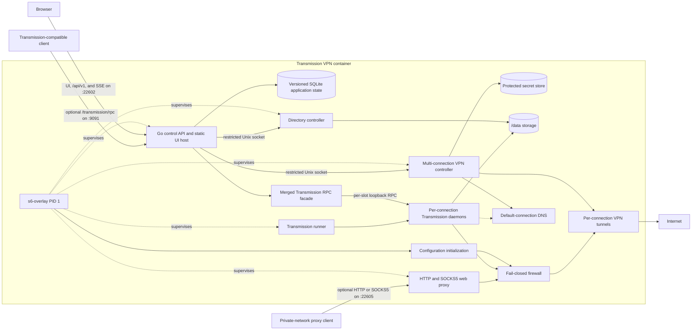

# PROJECT_RULES.md

## Project Identity

### Name and Description

- **Project name:** Transmission VPN (`transmission-vpn`)
- **Description:** A secure Transmission container routed through a VPN with a modern,
  familiar web interface.
- **Primary language:** Go for the appliance control plane and TypeScript for the
  first-party interface.
- **Framework / runtime:** Docker, s6-overlay, Transmission, OpenVPN, WireGuard, a Go
  control API, and a React interface compiled by Vite and served by the Go process.

### Repository URL

- **URL:** https://github.com/mrjackyliang/transmission-vpn

## Repository Structure

### Repository Layout

```text
transmission-vpn/
|-- apps/
|   |-- transmission/      - Nova Docker application workspace
|   `-- docs/              - Docusaurus documentation workspace
|-- conventions/           - Nova-generated agent and coding conventions
|-- assets/
|   `-- legacy/            - Local original Synology scripts retained as reference
|-- scripts/                - Root maintenance and Nova-linking scripts
|-- tests/                  - Root project-contract tests
|-- AGENTS.md               - Codex project instructions
|-- CLAUDE.md               - Claude Code project instructions
|-- nova.config.json        - Nova project metadata and workspace definitions
|-- package.json            - Nova monorepo root manifest
|-- PROJECT_RULES.md        - Architecture, scope, and project guardrails
`-- VISION.md               - Product purpose and experience direction
```

### Source Structure

The workspace package name is `transmission-vpn-app-transmission`. Its pinned Debian
container builds the newest release of the Transmission series set in the `Dockerfile`
from the official checksummed upstream source and includes the s6 lifecycle, fail-closed
firewall, OpenVPN and WireGuard controller, Transmission daemon, authenticated control
API, and responsive first-party web interface. The maintained UI coverage is recorded
under Project Guardrails, and remaining interface depth is recorded in `VISION.md`.

The repository has one root Docker build context and one container deliverable.
`Dockerfile`, `compose.yml`, and `.dockerignore` are the public container entry points;
the private `packages/docker` workspace owns the image manifest, root filesystem, s6-rc
database, and container-specific tests. Application source stays in
`apps/transmission`, while the root multi-stage build copies only that selected
workspace and its explicit build inputs. The documentation workspace is not copied into
the image and remains independently publishable through GitHub Pages.

The canonical s6 user bundle lives at
`packages/docker/rootfs/etc/s6-overlay/user-bundles.d/user/contents.d`. The deprecated
`s6-rc.d/user` compatibility path and workspace-local Docker entry points are not part
of the architecture.

## Build and Tooling

### Prerequisites

Use a Node.js version permitted by the root manifest, npm, Docker with Compose support,
and the Go, React, Transmission, VPN, and base-image versions declared by the maintained
workspace manifests and container files.

### Commands

Use the root `dev`, `prod`, `check`, `build`, `deploy`, `clean`, `changelog`, and
`recipes` commands for repository-wide work. Nova orchestrates the root, container, and
documentation workspaces from the configuration in `nova.config.json`.

| Command                                                                 | Purpose                                                   |
|-------------------------------------------------------------------------|-----------------------------------------------------------|
| `npm run dev --workspace transmission-vpn-app-transmission`             | Build and run the development container in the foreground |
| `npm run dev:web --workspace transmission-vpn-app-transmission`         | Run the Vite interface development server                 |
| `npm run check:types-web --workspace transmission-vpn-app-transmission` | Type-check the interface                                  |
| `npm run build:web --workspace transmission-vpn-app-transmission`       | Build the production interface assets                     |
| `npm run check --workspace transmission-vpn-app-transmission`           | Run the generated configuration and test checks           |
| `npm run build --workspace transmission-vpn-app-transmission`           | Build the Docker Compose image                            |
| `npm run deploy --workspace transmission-vpn-app-transmission`          | Build and start the Docker Compose service                |

### Environment Variables

Keep host-owned deployment settings in the documented Compose or configuration boundary.
Supply credentials and encryption material through permission-restricted secret files;
never commit them, bake them into an image, or expose them through read APIs.

## Workspace Rules

### Workspace Inventory

Workspace ownership, roles, and policies are declared in `nova.config.json`; repository-specific naming and behavioral rules are documented in the sections below.

## Architecture and Data

### Architecture

This section records the accepted implementation architecture. Runtime, safety,
control-plane, and first-party interface boundaries are defined here.

#### Architectural Goals

- Deliver Transmission, OpenVPN and WireGuard tunnels, leak protection, and the
  first-party control experience as one container.
- Use s6-overlay as PID 1 and the supervisor for initialization, long-running services,
  orderly shutdown, and log ownership.
- Keep each Transmission fail-closed before its tunnel starts, while that connection
  reconnects, and while the container stops.
- Preserve the functional depth of `transmission-web-control` without carrying forward
  its code or visual design.
- Move routine Transmission and VPN configuration into the application UI instead of
  requiring a large environment-variable surface.
- Support OpenVPN and WireGuard providers through a stable adapter boundary, with
  maintained PureVPN, Private Internet Access, IPVanish, NordVPN, Surfshark, IVPN,
  Mullvad, and custom paths.
- Keep the deployment contract small enough for a normal Docker or NAS installation.

#### Accepted Decisions

| Area                  | Decision                                                                                                                                                    |
|-----------------------|-------------------------------------------------------------------------------------------------------------------------------------------------------------|
| Packaging             | One purpose-built container owns Transmission, VPN, API, and web UI.                                                                                        |
| Container OS          | The release- and digest-pinned Debian base image in the `Dockerfile` provides the runtime base.                                                             |
| Transmission delivery | Build the newest release of the `Dockerfile`'s Transmission series (4.1 or newer) from its checksummed source archive.                                      |
| Process supervision   | s6-overlay and native s6-rc service definitions manage the process tree.                                                                                    |
| VPN protocols         | OpenVPN and WireGuard share one driver contract and safety path; each connection owns a slot-specific interface.                                            |
| VPN connections       | One or more connections may run at once; each owns a slot, tunnel, Transmission daemon, peer port, and status.                                              |
| Default connection    | One connection handles torrents in the Default profile, unmatched or unresolved remote adds, and DNS for every Transmission; nullable selections follow it. |
| Per-slot routing      | Slot `n` uses `198.18.<n>.1`, its own policy table and unreachable fallback, and SNAT at its tunnel boundary.                                               |
| Initial providers     | Support began with PureVPN and custom uploads; seven built-in catalogs now use the adapter contract.                                                        |
| Management surface    | A first-party control API and web UI manage the complete appliance.                                                                                         |
| Configuration         | The UI owns routine settings; deployment inputs remain intentionally small.                                                                                 |
| Application state     | SQLite stores versioned application settings and bounded history.                                                                                           |
| Control API runtime   | The Go version declared by its module and the standard HTTP stack ship as one static appliance binary.                                                      |
| SQLite implementation | Pure-Go `modernc.org/sqlite` with embedded, ordered SQL migrations.                                                                                         |
| Managed configuration | One declarative document may seed or lock individual settings.                                                                                              |
| Access model          | The administrator uses sessions and scoped API tokens, remote apps use RPC logins, and proxy clients use proxy logins.                                      |
| Transmission RPC      | Every connection's native RPC stays on a separate container-loopback port and is accessed through the control plane.                                        |
| Compatible RPC        | An optional authenticated facade combines all daemons and exposes only its fixed method and session-setting allowlists.                                     |
| Network protection    | Each Transmission source address has only its connection's verified tunnel path, plus a firewall source backstop.                                           |
| Firewall backend      | The initial safety boundary uses an iptables compatibility layer that prefers legacy tables on older NAS kernels, then nft.                                 |
| Web proxy             | Opt-in HTTP and SOCKS5 proxy on `22605`; each login selects a connection or follows the default and remains fail-closed.                                    |
| UI implementation     | React and TypeScript versions declared by the workspace manifest compile through Vite.                                                                      |
| Published HTTP shape  | UI, `/api/v1`, and events use `22602`; compatible RPC uses `9091`; the opt-in web proxy uses `22605`.                                                       |

- Refresh PureVPN endpoints only on an authenticated administrator request from its
  official recommended OpenVPN bundle, validating the whole catalog before replacement.
- Implement provider integrations behind a data-oriented adapter boundary rather than
  placing provider-specific behavior in the networking core.
- Keep routine Transmission, VPN, endpoint, and health configuration in the UI.
- Apply the embedded SQL migrations atomically with WAL,
  foreign-key enforcement, and a bounded busy timeout.
- Limit deployment configuration to host-owned concerns, optional PUID, PGID, and
  timezone overrides, file-based secrets, and one declarative configuration document.
- Let each managed configuration field seed an unset value or lock the effective value;
  make the source and lock state visible in the UI.
- Default runtime identity and time settings to `1000:1000` and `UTC`, while allowing
  explicit deployment overrides.
- Limit UI-selectable storage paths to approved mount roots such as `/data`.
- Keep torrent data in profile-owned folders inside `/data`, never in `/data` itself.
  Profile folders, the incomplete folder, adds, profile changes, and remote-app requests
  refuse the mount root, while browsing and folder creation still start there.
- Keep the incomplete folder for unfinished downloads only, found from its setting rather
  than its name. No download folder may be it or sit inside it, and it may not contain
  the Default profile's folder or a named profile's folder.
- Give every profile one unique download folder at all times. The Default profile's folder
  is the live `transmission.downloadDirectory` setting, which can't be empty and defaults
  to `/data/downloads`; every add names its selected profile's folder.
- Create that folder, the incomplete folder while it's on, and each profile's folder when
  they're missing, owned by `PUID:PGID` like folders made in the browser. A failure is
  logged and never blocks startup or a save.
- Accept provider credentials through the UI or secret files, encrypt them with a
  generated or externally supplied key, and never return their values through read APIs.
  Reads list which credential fields are saved, and an update to a saved connection keeps
  a field left empty unless its provider or tunnel changes.
- Support one local administrator in the initial release.
- Never publish the native Transmission daemon listener through the optional
  authenticated compatibility route.
- Keep native Transmission RPC bound to container loopback on `127.0.0.1:9092+slot`;
  remote apps authenticate with their own RPC login, which works only on the RPC facade.
- Apply settings as validated transactions, test VPN candidates before committing,
  explain restart requirements, and require confirmation for controlled restarts.
- Provide secret-free settings exports, encrypted full backups, bounded rollback
  history, and a non-executing guided importer for `.env`, Compose, and `docker run`
  inputs.
- Accept provider data from built-in catalogs, authenticated uploads, and optional
  read-only managed bundles through the same adapter contract.
- Offer safe OpenVPN controls plus validated expert directives, rejecting executable or
  protection-weakening behavior.
- Support sticky, ordered, and randomized endpoint strategies, selectable leak-safe DNS,
  and safe multi-probe VPN health checks with advanced overrides.
- Reserve provider-adapter capabilities for forwarded ports without requiring an
  automated provider integration in the initial release.
- Expose the complete supported Transmission settings inventory through organized,
  validated advanced controls and support multiple scheduled blocklist sources.
- Keep each Transmission locally manageable while its VPN reconnects, but enforce
  blocked external traffic for that slot until protection is verified.
- Send alerts for VPN outages and recovery, finished or failed torrents, sign-in
  lockouts, and removed secrets to administrator-configured destinations such as ntfy,
  Telegram, Discord, Slack, email, Apprise, and webhooks, in the background with a
  10-second limit per send and no retries.
- Offer an opt-in web proxy (HTTP and SOCKS5) on published port `22605` for clients on
  private networks. It is disabled by default, always requires its own username and
  password, and routes each login through its selected or effective default connection.

#### System Context



The control plane remains reachable from its published port even when every VPN
connection is unavailable. Each data-plane slot remains blocked until that connection
is verified. Native Transmission listeners never bind to a published port.

#### Responsibility Boundaries

##### s6-overlay

s6-overlay owns PID 1 behavior, signal handling, child reaping, service dependencies,
restart policy, and reverse-order shutdown. Services use native s6-rc definitions
rather than the legacy `/etc/services.d` compatibility path.

s6-overlay starts through `/init` as root so initialization can establish the firewall,
tunnel, users, and runtime directories. This is an intentional container-specific
exception; service processes receive only the identity and privileges they need.

s6 does not decide whether the VPN is safe. It supervises the processes that calculate
and enforce that state.

##### Configuration Initialization

The initialization one-shot validates persistent storage, applies schema migrations,
creates runtime directories, and checks the configured or defaulted PUID and PGID. The
image defaults to `1000:1000` and `UTC`, while deployments may override PUID, PGID, and
timezone without changing application state. Initialization does not recursively change
ownership across the download volume.

An explicit, scoped repair action may be offered later for users who want the product
to correct a selected directory.

##### Firewall Boundary

The firewall one-shot establishes the deny-first network policy before any tunnel or
Transmission daemon starts. It creates owner chains for the Transmission and web proxy
accounts, then projects per-connection accept rules that require the slot's fixed source
address and verified interface. A source-address backstop ahead of the owner chains
drops `198.18.0.0/18` traffic that does not match its protected interface. Provider
addresses are applied with per-interface SNAT, so duplicate provider addresses remain
isolated.

The rules use an iptables compatibility layer that prefers legacy tables for older NAS
kernels and falls back to the nft-backed frontend when required. The selected backend
and protected interface projections are recorded as runtime state so health checks and
teardown use the same ruleset implementation.

The firewall stays active until every Transmission daemon, the web proxy, and the VPN
controller have stopped. A firewall setup failure prevents protected services from
starting.

##### VPN Controller

The VPN controller is the only long-running component allowed to perform privileged
network operations. It owns independent state and operation gates per connection,
resolves provider profiles, selects endpoints, starts and stops slot-specific tunnels,
verifies them, rotates failed endpoints, and publishes one normalized status per
connection.

The control API sends versioned, validated `status`, `connect`, `restore`, `disconnect`,
and `set-default` commands through a permission-restricted Unix socket. Each connection
command carries its identifier and slot; connect and restore also carry the default flag
and normalized connection. The protocol cannot execute arbitrary commands or accept
raw firewall arguments.

##### Transmission Runner and Daemons

Each connection runs one Transmission daemon, which remains the source of truth for that
connection's torrents, session statistics, peer state, and RPC-supported settings. All
daemons run as the configured unprivileged PUID and PGID, or the `1000:1000` defaults
when overrides are absent.

The unprivileged runner reads the daemon list published by the control API. Slot `n`
uses `/config/transmission/<connection-id>/`, native RPC on `127.0.0.1:9092+n`, and
source address `198.18.<n>.1`. The runner writes one state document per connection,
publishes the default daemon's readiness only after an RPC handshake, and publishes a
healthy `no-connections` marker when the list is empty.

The same runner owns the multi-source blocklist merger. It downloads only while the
default connection is `protected`, resolves names through that connection's DNS, and
binds every HTTPS socket to the default slot's `198.18.<n>.1` address. Sources and up to
five redirects must remain credential-free HTTPS. A source gets 30 seconds to connect,
five minutes overall, 64 MiB downloaded, 512 MiB unpacked, 128 MiB normalized, and
2,000,000 accepted ranges. Zip sources are limited to 1,000 entries and an 8 MiB central
directory. The normalized set across all sources is limited to 256 MiB and 3,000,000
ranges. Plain, gzip, and zip lists may contain Transmission P2P, DAT, or CIDR ranges for
IPv4 or IPv6. A source failure keeps its last-good copy.

Normalized output remains in bounded disk-backed files and is streamed into each
daemon. The runner caches saved copies after its first load, publishes status only when
content changes, returns an interrupted update to `waiting-for-vpn` without recording an
attempt, and backs off a failed installation for 15 minutes or the configured interval,
whichever is sooner. Daemon starts install available cached copies without downloading;
the scheduled loop exclusively owns updates.

For every prepared daemon, the runner opens `blocklists/` without following links,
atomically writes one `tvpn-<source-hash>.txt` per usable source relative to that folder
descriptor, and removes only stale regular files. It never creates a daemon's config
directory. Before any SIGHUP, it merges the daemon's live `session-get` state over the
current `settings.json`, reapplies runner-owned bind, peer-port, RPC, and blocklist keys,
and writes the result. A child becomes signalable only after its RPC socket answers; a
replacement completed while it starts is reloaded once after readiness. The API
publishes desired state in
`transmission-config/blocklists.json`; the runner publishes scheduling, per-source
results, retained-copy timestamps, and the total in-use range count in
`transmission-state/blocklists.json`.

Confirmed restarts republish every native configuration and restart the daemons without
reconnecting tunnels. A daemon can stay running while its VPN reconnects so local
management remains available, but its external traffic fails locally until protection
returns. Pending restart keys are retained only while at least one daemon is running;
with none running, saved settings apply at its next start without a restart notice.

##### Web Proxy

The optional web proxy runs as its own unprivileged `webproxy` user. HTTP and SOCKS5
share published port `22605`, and every client must supply the proxy's own username and
password.

Clients must originate on private networks, and destinations must be public IPv4
addresses. Each login names a connection or follows the default. The proxy resolves
names with that connection's DNS servers, binds destination sockets to its fixed slot
address, and refuses the request unless that connection is `protected`.

##### Directory Controller

The directory controller is a narrow storage helper supervised by s6 and run as the
same unprivileged PUID and PGID as Transmission. It lists immediate folders, creates one
direct child, and deletes exactly one empty folder at a time beneath `/data`. It cannot
read file contents, rename paths, perform recursive operations, or choose another root.

The control API reaches the helper through a permission-restricted Unix socket. Every
request is checked against the fixed `/data` boundary, and normalized traversal paths,
files, and symbolic links are rejected. New folders receive Transmission-compatible
ownership and permissions without granting the control API access to download data or
granting Transmission access to control-plane secrets.

##### Control API

The control API is the container's published control-plane service. It serves the
compiled web application, authenticates the local administrator, scoped API tokens, and
RPC logins, manages application settings and VPN connections, combines daemon torrents
and statistics, and routes mutations to the owning connection.

The API runs unprivileged and does not read secrets back to clients. It is implemented
in Go with the standard `net/http` stack, keeping the published boundary small and
avoiding a second runtime inside the appliance. State changes are exposed under the
versioned `/api/v1` route. An authenticated server-sent event stream at
`/api/v1/events` publishes replaceable appliance, VPN, Transmission statistics, and
torrent snapshots. One shared two-second refresh loop serves all connected browsers.

The compatible RPC facade preserves the session handshake and exposes a fixed method
set. It merges `torrent-get`, sums session statistics, routes torrent mutations by
facade identity, sends unmatched adds to the default connection, and fans accepted
session settings to every daemon. `session-set` canonicalizes key spelling, permits only
its fixed allowlist, refuses scripts and port controls, and keeps every folder inside
`/data`, never `/data` itself, as adds and relocations do. `session-close` and unknown
methods are refused. Unknown torrent identifiers are not forwarded, so remote apps
cannot remove or relocate torrents outside the merged view.
`blocklist-update` is handled by the application merger instead of being sent to native
daemons: it publishes an update request, waits up to 60 seconds, and returns the merged
`blocklist-size` or a Transmission result error.

The React application is compiled during the image build and served by the Go process;
Node.js is not present in the runtime image. Browser navigation uses an SPA fallback,
while `/api/` and `/transmission/` paths never fall back to HTML.

#### s6 Service Graph

```text
base
`-- config-init (oneshot)
    |-- directory-controller (longrun)
    |   `-- control-api (longrun)
    `-- firewall-init (oneshot)
        |-- vpn-controller (longrun)
        |-- transmission (longrun)
        `-- web-proxy (longrun)
```

The directory controller starts after storage and identity validation, and the control
API starts after its local socket is ready. First-run setup remains available even when
VPN configuration is missing or invalid. The protected services cannot start until the
firewall boundary exists.

Tunnel readiness is runtime state rather than an s6 dependency. The firewall is the
hard safety boundary, while the VPN controller reports transitions to the API.

#### Runtime Lifecycle

##### First Boot

1. s6-overlay starts and runs configuration initialization.
2. Persistent paths and schema versions are validated.
3. The fail-closed firewall policy is installed.
4. The control API starts in `setup-required` mode.
5. The Transmission runner publishes `no-connections`; no daemon is required yet.
6. The first-run UI claims the installation, creates a connection, and tests its
   proposed tunnel before committing it.

##### Normal Startup

1. The application state and secret references are validated.
2. The fail-closed policy is installed before protected processes start.
3. The runner starts one Transmission daemon for each connection and binds it to the
   slot's fixed private address.
4. The VPN controller restores each enabled connection on its slot-specific OpenVPN or
   WireGuard tunnel.
5. Each tunnel interface, source route, DNS behavior, and protected egress are verified.
6. Per-connection states and the combined `protected`, `partial`, or `blocked` state are
   published.

##### VPN Failure and Recovery

1. A tunnel, source route, DNS, or egress verification failure blocks that connection.
2. Its fixed source route fails locally, and the firewall backstop continues dropping
   wrong-interface traffic without waiting for API or process coordination.
3. Other protected connections continue to carry their own Transmission and proxy
   traffic.
4. The UI remains reachable and reports the failed connection, endpoint, and recovery
   step while the controller retries its endpoint policy.
5. That connection's traffic resumes only after the complete protection check succeeds.

##### Shutdown

1. The API publishes the `stopping` state and refuses new configuration mutations.
2. Every Transmission daemon and the web proxy stop while the deny-first firewall
   remains installed.
3. The VPN controller stops all tunnels and exits.
4. Temporary routes, generated files, and firewall rules are removed only after the
   protected processes are gone.

#### VPN Provider Architecture

##### Provider Contract

Each provider adapter supplies a common, data-oriented contract:

- Stable provider identity, display metadata, and capability flags.
- The tunnels it offers, OpenVPN, WireGuard, or both, each with its own credential
  fields, validation requirements, and catalog source.
- Built-in catalog, local upload, or managed bundle acquisition behavior.
- Normalized endpoint metadata such as country, city, transport, and protocol.
- OpenVPN profile and WireGuard configuration validation and safe normalization.
- Optional provider-specific port-forwarding lifecycle.
- Actionable error messages and health context.

Adapters cannot weaken the global firewall policy or inject arbitrary executable hooks.
The UI renders provider forms and features from capabilities instead of embedding
provider-specific branches throughout the application.

##### Initial Providers

- **PureVPN** supports the current migration path and proves a maintained provider
  catalog with endpoint selection. An authenticated refresh downloads PureVPN's fixed
  official recommended OpenVPN ZIP, validates and normalizes every profile, encrypts
  profile contents, and atomically replaces the previous catalog.
- **Private Internet Access** merges the provider's public strong-encryption UDP and
  TCP archives into one location-aware catalog.
- **IPVanish** imports the provider's public OpenVPN server archive supported by the
  OpenVPN version pinned in the `Dockerfile` and derives searchable country, city,
  virtual-location, and server metadata.
- **NordVPN** imports the provider's public archive of every server, keeps only the
  profiles supported by the OpenVPN version pinned in the `Dockerfile`, and labels
  Double VPN and Onion over VPN servers. Its source sets a larger size cap and time
  limit than the shared catalog defaults. Its WireGuard list comes from NordVPN's
  public server list and each server's published key.
- **Surfshark** imports the provider's public archive of one profile per location and
  names each location's city from a table built into the image. Its WireGuard list
  comes from the provider's public cluster list.
- **IVPN** merges the provider's public UDP and TCP location archives, and builds its
  WireGuard list from the provider's public server status list.
- **Mullvad** offers WireGuard only, built from the provider's public relay list.
- **Custom** accepts a user-supplied OpenVPN profile bundle and supporting certificate
  files, or a complete WireGuard file with its own private key, making unsupported or
  private providers usable without a core integration.

Provider material may come from a maintained built-in catalog, an authenticated UI
upload, or an optional read-only managed bundle mount. Every source passes through the
same adapter validation and becomes data; none can add executable startup hooks.

WireGuard catalog entries are templates without a private key. The user's key, and the
tunnel address when the provider assigns one per key, are merged in at connect time and
never stored in a catalog.

Additional providers enter through the same contract after their profile lifecycle and
maintenance source are understood.

The UI exposes safe OpenVPN controls for common needs. An expert editor accepts only
validated directives, while custom profiles are parsed and normalized before use.
Directives that execute programs or weaken the global firewall and routing policy are
rejected.

WireGuard files are rewritten to one canonical form: exactly one peer, `AllowedIPs`
fixed to `0.0.0.0/0`, `PersistentKeepalive` fixed to 25 seconds, and IPv4 only.
`PreUp`, `PostUp`, `PreDown`, `PostDown`, `Table`, and `FwMark` are rejected, and IPv6
addresses, DNS servers, and routes are removed, so a file can neither run a program
nor widen what leaves the tunnel.

##### Tunnel Drivers

The VPN controller runs each connection through a slot-specific driver with one
contract. The controller keeps every safety step for both tunnel types: installing the
fixed source route and unreachable fallback, blocking the slot, verifying the tunnel,
opening the firewall for the source-interface pair, and guarding reconnects against
stale attempts. Only the default connection owns the container resolver projection.

- **OpenVPN** runs one child for each active connection on `tun<slot>`, and the child's
  exit ends that connection's session.
- **WireGuard** creates `wg<slot>` with the kernel module, or with a slot-specific
  `wireguard-go` process when the kernel has none, and configures it with `wg` only;
  `wg-quick` is never used. Traffic uses the slot's protected table only after the
  server answers a handshake. The driver's routes keep the endpoint and private LAN
  ranges outside the tunnel. A dead server is noticed from handshake age and repeated
  TCP checks. Kernel WireGuard marks its encrypted UDP packets, which the owner chains
  accept; unprivileged services cannot set that mark.

##### Endpoint Pools

The application stores endpoint identifiers rather than a comma-separated configuration
string. Users can search and filter endpoints, choose eligible locations, order
preferences, and select sticky-until-failure, ordered, or randomized routing strategies.

The controller records failures and the active endpoint without silently deleting the
user's pool. Profile catalog updates are validated and applied atomically.

The provider contract reserves capability metadata and lifecycle hooks for forwarded
ports. The initial release does not require an automated provider-specific integration;
one can be added later without changing the controller boundary.

#### Control API Contract

- Provide one authenticated origin for the web application and application API.
- Negotiate Transmission RPC capabilities behind a stable application-facing adapter.
- Expose torrent, session, file, peer, tracker, statistics, and settings operations.
- Expose normalized VPN, endpoint, firewall, DNS, health, and recovery state.
- Validate settings as a complete transaction before changing persistent state.
- Report whether an accepted change applies live or requires a controlled restart.
- Stream replaceable state snapshots to the UI over authenticated server-sent events.
- Use a narrow, typed command contract for privileged VPN actions.
- Encode every list as an array, never `null`, in replies, events, RPC results, and
  notification payloads.
- Version the external API before supporting third-party clients.
- Optionally expose an authenticated Transmission-compatible RPC proxy without
  publishing the daemon listener.

#### VPN Connection Routes

- `GET` and `POST /api/v1/vpn/connections` list and create connections, with the list
  response carrying detected capacity and current usage.
- `GET` and `PUT /api/v1/vpn/connections/{id}` read and update one connection. Name and
  peer-port-only updates avoid a tunnel reconnect; other updates test before commit.
- `POST /api/v1/vpn/connections/{id}/reconnect` and `/disconnect` operate on one slot.
- `DELETE /api/v1/vpn/connections/{id}` refuses the default and reports current torrent,
  profile, and proxy-login use. Its optional `moveTo` target moves those references and
  torrents before the source is disconnected and deleted.
- `PUT /api/v1/vpn/default` changes the effective default, republishes DNS, daemons, and
  proxy configuration, and moves the Default profile's torrents to the new default. When
  any would move, it answers `409 torrents_must_move` until the request sends
  `moveTorrents: true`.

Connection capacity is the smaller of memory and CPU capacity: reserve 256 MiB, allow
one connection per remaining 160 MiB, allow two connections per available CPU, and
clamp the result from 1 through 64. Memory detection reads cgroup v2, cgroup v1, then
`/proc/meminfo`; CPU detection reads cgroup v2 quota before the Go runtime count. A
complete memory-detection failure uses a conservative capacity of two.

#### Torrent Ownership, Moves, and Removal

Every torrent is assigned to the Default role or one named profile. Adds use that
profile's folder and effective connection; an unmatched add uses the Default profile. A
remote add with several name-pattern matches and no folder or label decision is paused
in the Default folder and connection and records its candidates until a profile is
chosen. An add whose info hash already lives on another connection returns that torrent
instead, and a link add, whose hash is known only after Transmission fetches it, goes in
paused and starts only after that check. Moves occur after **Save and move** changes an
assigned profile's folder or connection, when a torrent changes profile, when connection
removal supplies `moveTo`, when a named profile with torrents is deleted, and when another
connection becomes the default.

Deleting a named profile with torrents needs `moveTorrents: true` (otherwise
`409 torrents_must_move`). Its torrents join the Default profile, their files move to its
folder, and torrents on another connection move to the default connection. Making another
connection the default moves the Default profile's torrents the same way. Labels and
per-torrent settings stay unchanged, and a torrent whose move fails stays where it is.

A move snapshots metainfo or magnet data, download location, labels, wanted files, file
priorities, renamed paths, bandwidth group, per-torrent speed, seeding and peer limits,
and running state. It adds the target paused, restores those values,
removes the source without deleting data, verifies the target, and restarts it when the
source was active. The source stays untouched when the target add fails. Uploaded totals
and ratio counters begin from zero on the target daemon. Failures stop connection
removal; post-transfer verification or restart failures are returned as warnings.

The compatible RPC proxy is disabled by default. When enabled, it preserves native
Transmission request and response semantics, including the `409` session identifier
handshake, behind the application authorization boundary. It presents the merged daemon
set as one Transmission without publishing any daemon listener.

### Data Flow and Ownership

#### Protection State Model

| Overall state    | UI available | Meaning                                                               |
|------------------|:------------:|-----------------------------------------------------------------------|
| `setup-required` | Yes          | No usable default connection is committed, or setup is incomplete.    |
| `protected`      | Yes          | Every enabled connection is protected.                                |
| `partial`        | Yes          | At least one enabled connection is protected and at least one is not. |
| `blocked`        | Yes          | Connections exist, but no enabled connection is protected.            |
| `error`          | Yes          | The firewall boundary cannot be confirmed.                            |

Each connection independently reports `setup-required`, `connecting`, `protected`,
`reconnecting`, `disconnected`, `blocked`, or `error`, plus its daemon's `starting`,
`ready`, `exited`, or missing state. Only a `protected` connection may carry its slot's
Transmission or proxy traffic.

There is no user-selectable state that permits Transmission to use an unprotected
interface. Disconnecting a connection means blocking its Transmission networking, not
bypassing it. Each web proxy login follows its effective connection and has no bypass.

#### Configuration Model

##### Configuration Classes

| Class                 | Examples                                                   | Owner             |
|-----------------------|------------------------------------------------------------|-------------------|
| Host deployment       | Volumes, published port, capabilities, TUN device          | Docker or Compose |
| Runtime identity      | PUID, PGID, timezone                                       | Deployment        |
| Application settings  | Incomplete storage, queue, global peer, ports, blocklists  | Control API       |
| Torrent profiles      | Folders, VPN choices, labels, seeding, speed, peers, queue | Control API       |
| VPN connections       | Name, slot, default, peer port, provider, pool, DNS, retry | Control API       |
| Secrets               | Provider credentials, setup claim, API credentials         | VPN/control layer |
| Derived runtime state | Tunnel config, routes, firewall rules, active endpoint     | Runtime only      |

##### Configuration Sources and Precedence

The normal deployment surface is limited to host-owned Docker settings plus optional
PUID, PGID, and timezone overrides. Routine application and VPN settings do not receive
one-to-one environment-variable aliases.

Automated deployments may mount one versioned declarative configuration document. Each
field in that document is explicitly either a seed or a lock. Secret fields contain
references to mounted secret files rather than inline credentials:

1. Host deployment constraints and runtime safety invariants cannot be overridden by
   application configuration.
2. A locked field overrides persisted UI state and appears read-only.
3. Persisted UI state overrides defaults and any seed that has already been consumed.
4. A seed initializes an unset field once and does not overwrite a later UI change.
5. Product defaults apply when no other source supplies a value.

Every setting exposes its effective value, source, lock state, validation status, and
apply impact. The Default profile's Download folder and Settings' Incomplete folder
use the folder-tree picker and may select only folders inside approved mount roots such
as `/data`, never the mount root itself; arbitrary host paths and unrestricted container
paths are not accepted. Directory selection uses the authenticated browser API, which
lists only real folders, supports single-folder creation and one non-recursive empty-folder
deletion, and rejects symbolic-link escapes. Assigned folders cannot be deleted: the
Default or a named profile's folder, the Incomplete folder in Settings, or a folder
where a torrent is saved. Folders inside the incomplete folder are also
Transmission-owned and cannot be deleted from the picker.

##### Persistent State and Transactions

The control plane stores versioned application state in SQLite at
`/config/app/state.sqlite3`. The database owns application settings, VPN connections and
slots, source and lock metadata, schema migrations, authentication metadata, bounded
configuration history, saved labels, named torrent profiles and their connection
selections, the profile assigned to each torrent, and references to protected secrets.
Transmission remains the source of truth for each
daemon's torrent and session state; the API maintains the merged identity-to-connection
view needed to route operations.

Configuration mutations are validated and committed as transactions rather than as
independent field writes. Each accepted change reports whether it applies live,
requires a controlled service restart, or requires a container restart. A required
restart is explained and waits for administrator confirmation.

VPN connection changes use a stage, activate, verify, and commit lifecycle. A candidate
replaces only its slot, and the connection's last-known-good snapshot is restored when
verification fails. Name and peer-port-only saves skip tunnel activation. The database
retains a small rolling history instead of an unbounded audit log.

##### Backup, Recovery, and Migration

The application supports both a portable settings export that excludes secrets and an
encrypted full backup that can include them. Restore operations preview and validate
the complete candidate before changing active state, preserve the current
last-known-good snapshot, and use the same transactional apply path as UI changes.

A guided migration tool accepts `.env` or Compose input and pasted `docker run`
commands. It parses these inputs strictly as data, never executes them, previews every
mapping, moves recognized credentials directly into protected storage, and reports
obsolete or unsupported values.

Normal UI changes persist across restarts and are not overwritten by bootstrap values.
The interface lists the editable name of the Default role first and named profiles
alphabetically; profiles have no saved order. The Default profile's current Download
folder is the live `transmission.downloadDirectory` value.

##### Persistent Layout

```text
/config/
|-- app/
|   |-- state.sqlite3    - Versioned application state and bounded history
|   `-- keys/            - Generated installation key when no external key is supplied
|-- transmission/
|   `-- <connection-id>/ - One daemon's home and daemon-owned state
`-- vpn/                  - Provider metadata, imported profiles, and encrypted secrets
/data/                   - User-selected download and incomplete directories
/run/transmission-vpn/
|-- controller.sock      - Versioned typed VPN controller protocol
|-- openvpn/<slot>/      - Slot-specific OpenVPN runtime files
|-- wireguard/<slot>/    - Slot-specific WireGuard runtime files
|-- vpn.status.d/        - One normalized VPN status file per connection
|-- vpn.status           - Compatibility copy of the default connection status
|-- transmission-config/ - Published daemon list, settings base, and blocklist desired state
|-- transmission-state/  - Per-connection runner state and merged blocklist status
|-- firewall.interfaces  - Protected interface, local address, and provider address rows
`-- services/            - Readiness markers, including no-connections
```

SQLite schema changes use ordered, deterministic SQL migrations embedded in the control
API binary and applied atomically through the pure-Go `modernc.org/sqlite` driver. The
database runs in WAL mode with foreign-key enforcement and a bounded busy timeout.

### Error Strategy

#### Health Model

Health and protection are related but distinct:

- **Liveness** confirms s6, the control API, and the safety controller are operating.
- **Readiness** confirms the default connection is protected and its Transmission is
  ready.
- **Protection** aggregates enabled connections as `protected`, `partial`, or `blocked`,
  while the status view also reports every connection and daemon independently.

The Docker health check uses control-plane liveness, the firewall safety boundary, and
the default Transmission RPC listener when a connection exists. A container with no
connections is healthy through the runner's `no-connections` marker, while readiness
still reports setup required.

The UI should expose all three states and the last transition reason. Health targets are
implemented as a safe multi-probe policy covering tunnel presence, protected routing,
DNS resolution, and external egress. Advanced settings may override probe targets and
timing without reducing the required protection checks to a single successful host.

Each connection selects validated provider-supplied or custom resolvers. Only the
default connection projects container DNS, and every Transmission lookup uses its fixed
source address and tunnel. Lookups fail while the default connection is down. Web proxy
logins use the DNS servers of their effective selected connection.

## Project Guardrails

### Security, Privacy, and Secrets

#### Network and Security Invariants

- Use s6-overlay as PID 1 and native s6-rc service definitions for initialization,
  supervision, and reverse-order shutdown.
- Start the image through s6-overlay's `/init` as root so the firewall and tunnel can be
  established. This is a scoped exception to the generic non-root image-entrypoint rule;
  service-specific privilege separation remains required.
- Request only the capabilities and devices required for VPN networking, such as
  `NET_ADMIN` and `/dev/net/tun`; do not require Docker privileged mode.
- Network initialization requires elevated permissions, but long-running application
  processes are separated by responsibility. Transmission and the control API run
  unprivileged; among application services, only the VPN controller retains the required
  network authority.
- s6 and the VPN controller retain only the privileges required for process and network
  control.
- Slot `n` gives Transmission fixed address `198.18.<n>.1`, a source rule to table
  `1000+n`, and a permanent unreachable default. Its traffic can leave only through
  that slot's verified tunnel; while the tunnel is down, traffic fails locally.
- Firewall owner chains accept a slot address only on its matching verified interface,
  and an earlier source-address backstop drops any protected address that tries another
  route. Provider-facing SNAT is scoped to the interface and slot address.
- A tunnel may use the container interface only for its selected VPN endpoint and the
  minimum bootstrap DNS traffic required to reach it.
- Every Transmission DNS request uses the default connection's fixed address, resolver
  list, and tunnel. It cannot reach a host or container resolver while that connection
  is down.
- IPv6 is blocked in the initial release. A later tunnel implementation must prove the
  same fail-closed guarantees before IPv6 traffic can be enabled.
- The published control port and its established responses remain reachable without
  granting Transmission general access to the container interface.
- Every native Transmission RPC listener binds to its slot's loopback port and is not
  published directly.
- The control API is the only published control-plane surface and communicates with the
  privileged VPN controller through a restricted command boundary.
- Web proxy traffic binds to the login's effective connection address and leaves only
  through that verified interface, except replies to its own clients on private networks.
- The web proxy never reaches loopback or container-internal services.
- Remote provider data is treated as configuration data, never as executable shell
  code.
- DNS behavior, reconnect transitions, forwarded ports, and container health are
  covered by explicit verification before release.
- Base images and installed packages use deliberate, reproducible versions declared by
  their authoritative container files. Transmission is the one exception: the
  `Dockerfile` declares its series, and each build compiles that series' newest release,
  checked against the SHA-256 digest GitHub publishes for its source archive.

#### Secrets and Access

Provider secrets may enter through the authenticated UI or permission-restricted secret
files. Plaintext provider credentials are not part of the normal environment-variable
contract. Stored provider credentials use restrictive file ownership and are encrypted
at rest with a generated installation key by default; they must not be copied into image
layers, committed files, plaintext environment variables, read APIs, or logs. Managed
deployments may supply the encryption key through an external secret file so encrypted
state and key material can be backed up or controlled separately. Read APIs expose
whether a secret is configured, never its value.

Notification destination secrets, such as tokens, passwords, and webhook URLs, are
encrypted with the same key and never returned after saving. If the key is lost, they
are removed and the affected destinations stay paused until the secrets are entered
again.

An unclaimed installation emits a short-lived, one-time claim code to the container log
and also accepts an equivalent mounted claim-secret file. Claiming creates the single
local administrator supported by the initial release and permanently invalidates the
setup credential. Browser access uses authenticated sessions, while automation uses
revocable, scoped API tokens whose create dialog shows the plaintext value once in its
**Token for &lt;name&gt;** second step before **Done** closes it.

An optional Transmission-compatible RPC proxy may be enabled for existing clients. It
is disabled by default and is served at `/transmission/rpc` on published port `9091`.
Each remote app uses its own RPC login with a chosen username and a generated password
shown once and stored as a digest. The interface can rename the login, regenerate its
password, delete it, and show when it was last used. At least one VPN connection is
required before creating an RPC login or enabling the proxy. The switch does not depend on
logins: the proxy can be enabled with none, which refuses every sign-in, and logins can be
added or deleted while it is on or off. Failed sign-ins are limited per client. API tokens do not work on the RPC route,
and RPC logins do not work on the API. Authentication headers, browser cookies, and CSRF
headers are removed before native RPC payloads are handled by the merged facade and
routed to the owning loopback-only daemon. Web proxy logins are stored as password
hashes and select a connection or follow the default. At least one VPN connection is
required before creating a web proxy login or enabling that proxy, and failed web proxy
sign-ins are limited per client.

### Platform and Domain Rules

#### Product Scope Rules

##### Do

- Prioritize reliable Transmission-through-VPN operation before optional integrations.
- Preserve familiar Transmission terminology, status concepts, and high-frequency
  actions in the new interface.
- Preserve the functional depth users expect from `transmission-web-control`, including
  detailed torrent views, batch actions, and session configuration.
- Make VPN protection and failure state understandable from the main experience.
- Add advanced capabilities when they solve a demonstrated need and can be presented
  through strong information hierarchy and progressive disclosure.
- Keep common setup paths short, with safe defaults and clear validation.
- Prefer persistent UI configuration over environment variables for routine settings.
- Show each setting's source, lock state, validation status, and restart impact.
- Validate configuration changes transactionally and preserve a last-known-good state.
- Treat responsive behavior and accessibility as implementation requirements.

##### Don't

- Do not pursue feature parity with larger competing images merely to lengthen a feature
  list.
- Do not mistake a modern interface for a reduced feature set, use visual compactness
  to omit useful Transmission functionality, or omit advanced workflows solely to make
  screens sparse.
- Do not put every available setting on the primary torrent-management screen.
- Do not hide VPN failure, fallback routing, or degraded protection behind logs alone.
- Do not make the interface unfamiliar solely to look different from Transmission.
- Do not introduce provider-specific behavior into the core until its lifecycle and UI
  can remain maintainable.
- Do not let the web proxy use a route outside a login's verified connection, reach
  container-internal or private-network services, or accept a client without its
  username and password.
- Do not recreate a one-to-one environment variable for every UI setting.
- Do not accept unrestricted OpenVPN directives, WireGuard command hooks such as
  `PostUp`, or executable provider hooks.
- Do not expose the native Transmission RPC listener outside the container.
- Do not finalize deferred technical choices in incidental maintenance work.

##### Feature Admission Rule

A proposed feature should enter the product only when all of the following are true:

1. It solves a clear user problem within Transmission, VPN safety, or container
   operation.
2. Its default behavior is understandable without reading implementation details.
3. It does not weaken fail-closed networking or make protection state ambiguous.
4. It fits the primary interface cleanly or can be placed behind purposeful progressive
   disclosure.
5. Its maintenance cost is justified by regular use rather than theoretical flexibility.
6. Its API contract, responsive states, empty and error states, authorization boundary,
   and relevant safety behavior are verified before the workflow moves to implemented.

#### Interface and Theme Guardrails

- The interface should feel recognizable to Transmission users without cloning the
  deprecated `transmission-web-control` theme.
- Core torrent actions, filtering, queue visibility, speed information, and transfer
  progress should remain easy to locate.
- Files, priorities, peers, trackers, labels, directories, statistics, batch actions,
  and complete session settings belong in the functional inventory.
- VPN state should be a first-class status surface rather than a separate diagnostic
  afterthought.
- Advanced settings should use grouping, sensible defaults, contextual explanation, and
  progressive disclosure without removing expert controls.
- Visual modernization should improve hierarchy, readability, responsiveness, and
  accessibility rather than adding decoration alone.
- A functional-parity inventory must be written before deciding what to retain from the
  current third-party web interface.

#### UI Product Boundary

The architecture commits to a full-capability interface, not a visually minimal client.
The first functional inventory must cover:

- Adding torrent files and URLs, including drag and drop.
- Torrent filtering, search, pagination or virtualization, saved labels, and Default and
  named torrent profiles. The app records which profile each torrent belongs to.
- Batch start, stop, verify, remove, profile change, and queue operations.
- File selection and priority, peers, trackers, options, and activity details.
- Complete supported Transmission session settings, grouped and validated rather than
  presented as an unstructured property dump.
- Session statistics, speed controls, queue rules, ratios, and peer-port controls.
- Multiple blocklist sources with schedules, merge results, update status, and errors.
- VPN provider setup, endpoint pools, connection state, DNS, health, and diagnostics.
- Storage validation, setting provenance and lock state, access security, configuration
  backup, migration, rollback, and safe recovery actions.

The first-party interface uses the React version declared by the workspace manifest and
TypeScript, built by Vite with a custom CSS design system. It uses a dense desktop
torrent table, mobile torrent cards and bottom navigation, an always-visible protection
state, focused VPN and settings workspaces, and a dedicated remote-app access screen.
Below 1020 pixels, bottom navigation shows **Torrents**, **VPN**, **Apps**, and **More**;
the current **Torrents** tab opens a sheet with **Status**, **Profiles**, and **Labels**,
and **More** lists **Settings** and **Notifications**.
The control API remains the only backend boundary used by the interface; frontend
components never contact native Transmission RPC directly.

The maintained functional inventory and implementation status live in Implemented
Workflows below. New interface work should update that inventory when a workflow is
implemented, intentionally deferred, or rejected.

#### Implemented Workflows

This is the maintained first-party interface product inventory. It records which useful
workflows from Transmission and Transmission Web Control are implemented, partial, or
planned without copying the deprecated project's code or visual design.

The interface is one responsive application served with the control API on port `22602`.
Its primary workspaces are Torrents, VPN, Remote Apps, Settings, and Notifications, with
**Sign-in and security** in the account menu. VPN protection and connection diagnostics stay
in the VPN workspace, while live application state remains available without presenting
setup warnings in unrelated workspaces.

| Area                | Current status | Included behavior                                                                                                                                                                                                                                                                                                                                                                                                                                                                                                                                                                                  |
|---------------------|----------------|----------------------------------------------------------------------------------------------------------------------------------------------------------------------------------------------------------------------------------------------------------------------------------------------------------------------------------------------------------------------------------------------------------------------------------------------------------------------------------------------------------------------------------------------------------------------------------------------------|
| First-run access    | Implemented    | One-time claim, local administrator creation, login, logout, and CSRF-protected sessions.                                                                                                                                                                                                                                                                                                                                                                                                                                                                                                          |
| Torrent overview    | Implemented    | Dense sortable desktop table, responsive mobile layout, persistent organization sidebar ordered as Status, Profiles, and Labels with counts and actions, the editable Default profile first and named profiles alphabetically, connection tags, saved zero-count labels, search, removable active-filter pills at every width, queue position, rates, ratio, ETA, peer flow, progress, merged session statistics, pagination, range selection, and context actions.                                                                                                                                |
| Torrent actions     | Implemented    | Add magnets, URLs, or `.torrent` files with per-item profiles, profile-owned folders and connection routing, automatic name matching with a required choice for several matches, editable labels and paused state, read-only folder and VPN fields, result rows, and free-space feedback; a sandboxed `/data` profile-folder tree with folder creation and one empty, unassigned folder deletion at a time; multi-select; start; start-now; pause; verify; reannounce; queue reorder; Change profile; and remove with optional data deletion.                                                      |
| Torrent details     | Implemented    | Live overview with a piece map, read-only owning connection and location, magnet copy, metadata-aware root rename, per-file wanted state and priority, peers, trackers, a Profile field that reports and performs file and cross-connection moves plus optional label and limit application, editable labels, and per-torrent bandwidth, seeding, peer, and speed options.                                                                                                                                                                                                                         |
| VPN safety          | Implemented    | Combined protected, partial, or blocked state plus each connection's tunnel, WireGuard engine, endpoint, last handshake, transition time, Transmission readiness, and actionable errors.                                                                                                                                                                                                                                                                                                                                                                                                           |
| VPN configuration   | Implemented    | Capacity-aware connection list; connection details and status; default selection; per-connection name, peer port, provider, tunnel, endpoints, DNS, retry, credentials, connect, reconnect, and disconnect; metadata-only save; and removal that moves torrents, profiles, and proxy logins to a selected connection. Endpoints show the provider's P2P server note.                                                                                                                                                                                                                               |
| Settings            | Implemented    | One list of global incomplete-folder, queue, peer, randomized-port, and blocklist controls with source and lock visibility, apply impact, draft review, transactional save, and a pending **Restart Transmission** notice and action. The Default profile editor owns its editable name, live **Download folder** setting, read-only default connection, labels, and per-torrent defaults. Peer ports and VPN settings stay on each connection page, and the RPC facade switch stays on Remote apps.                                                                                               |
| Live state          | Implemented    | Authenticated server-sent snapshots for combined protection, every VPN connection and daemon, merged transfer statistics, and torrents, including partial protection and automatic reconnection.                                                                                                                                                                                                                                                                                                                                                                                                   |
| Remote apps         | Implemented    | Opt-in Transmission-compatible facade that merges every daemon, assigns adds by matching a profile folder, then labels, then name patterns, uses the Default profile when none match, and pauses a several-pattern tie in the Default folder and connection until the user chooses a profile; it forces the chosen profile's folder and connection, refuses `torrent-set-location`, and uses separate generated-password RPC logins. Scoped API tokens and an opt-in fail-closed HTTP and SOCKS5 web proxy whose separate logins select a connection or follow the default complete the workspace. |
| Notifications       | Implemented    | **VPN dropped**, **VPN back up**, **Torrent finished**, **Torrent error**, **Sign-in locked**, **Saved secrets were removed**, and **Profile choice needed** alerts sent to ntfy, ntfy-reverse-proxy, Telegram, Discord, Slack, Gotify, Pushover, Matrix, email, Apprise, or a webhook, with a test send per destination and secret fields sealed with the installation key. All seven events are selected for a new destination.                                                                                                                                                                  |
| Responsive behavior | Implemented    | Desktop and tablet sidebars plus a below-1020-pixel tab bar ordered as **Torrents**, **VPN**, **Apps**, and **More**. The Torrents page's **Filters** button opens the **Status**, **Profiles**, and **Labels** sheet, every page has its own address, active filters stay as removable pills under **Search**, and **More** lists **Settings** and **Notifications**. The account menu stays **Appearance**, **Sign-in and security**, and **Sign out** at every width.                                                                                                                           |
| Appearance          | Implemented    | Persisted System, Light, and Dark themes with a shared Transmission-red brand accent; System follows the operating-system preference as it changes.                                                                                                                                                                                                                                                                                                                                                                                                                                                |

### Compatibility

#### Rewrite Boundary

- Build the greenfield replacement in `apps/transmission` from Nova's container-native
  Docker scaffold.
- Keep the current Synology scripts under `assets/legacy/` only as behavioral and historical
  reference.
- Do not preserve Synology-specific paths, services, VPN identifiers, or scheduling
  assumptions in the new architecture.
- Do not begin by layering new container behavior over `transmission-vpn.sh`.
- Do not reuse or fork the deprecated `transmission-web-control` implementation. Create
  a maintained interface that covers the useful workflows identified during planning.
- Use Architecture and Data in this file as the source of truth for runtime boundaries,
  configuration ownership, protection invariants, and accepted technical decisions.

#### Transmission Series

- Set only the Transmission series, such as `4.1`, in the `Dockerfile`. Each build
  compiles that series' newest stable release and checks its source archive against the
  SHA-256 digest GitHub publishes for it.
- Move to a newer series only in a tested repository upgrade, because minor and major
  Transmission releases can change behavior the appliance depends on. The weekly upstream
  check reports when a newer series is out.
- Never set a series older than `4.1`. Trackers ban Transmission 4.0.6 for its bugs and
  ask for 4.1.0 or newer, so the build and `tests/project.test.ts` refuse older series.

## Testing and Verification

### Test Strategy

- Test control-plane behavior, state migrations, configuration transactions, provider
  adapters, and the interface independently where possible.
- Verify fail-closed networking, privilege separation, secret handling, restart behavior,
  and supported client compatibility at their integration boundaries.

### Required Verification

Use the commands under Build and Tooling. Changes must pass every check applicable to
the affected workspaces and container architectures.

The implementation is not complete until automated tests demonstrate that Transmission
cannot use an unprotected route during:

- Initial startup before the tunnel is ready.
- Provider authentication or profile failure.
- Tunnel, route, or DNS failure.
- OpenVPN process crashes, stale WireGuard handshakes, and endpoint rotation.
- Container network changes and IPv6 availability.
- Configuration changes and failed rollback.
- Normal container shutdown and forced process termination.

The web proxy cannot use an unprotected route during those same conditions.

The OpenVPN Docker integration check, `npm run check:openvpn --workspace
transmission-vpn-tool-docker`, must verify slot source binding, policy routing, SNAT,
fail-closed peer loss, and recovery. The two-connection check, `npm run check:multi-vpn
--workspace transmission-vpn-tool-docker`, must run two isolated tunnels and daemons,
verify per-slot routing and firewall projections, combined RPC, per-login proxy routes,
profile-driven torrent moves, removal with a move target, and duplicate WireGuard
provider addresses.

Additional integration tests cover s6 service ordering, privilege separation, settings
migrations, provider adapter contracts, Transmission RPC compatibility, and the
published `amd64` and `arm64` images. They also cover setup-claim invalidation, session
and token scopes, config-source precedence, migration inputs as non-executable data,
encrypted backup restore, bounded rollback, and restart confirmation.

## Documentation and Ownership

### Documentation Structure

- `VISION.md` is the source of truth for product purpose, audience, positioning, and
  experience principles.
- `PROJECT_RULES.md` is the source of truth for implementation boundaries and accepted
  decisions, runtime components, lifecycle, state, configuration ownership, and
  security invariants.
- `apps/docs/` owns the generated user-facing documentation site.
- Update the applicable source-of-truth files when a planning session resolves a
  deferred question.
- Keep speculative ideas labeled as deferred rather than presenting them as committed
  roadmap items.
- Do not regenerate `AGENTS.md`, `CLAUDE.md`, or `conventions/*.md` by hand; use Nova's
  agent-conventions generator.

## Publishing and Deployment

### Release Process

Publishing and deployment follow the workflows and workspace policies declared by the
repository. Do not present a deferred provider, client, registry, or interface decision
as released behavior until it is implemented and verified.

### Environments

#### Target Deployment Contract

The intended Docker interface is deliberately short:

```bash
sudo docker run -d \
  --name transmission-vpn \
  --restart unless-stopped \
  --cap-add=NET_ADMIN \
  --device=/dev/net/tun \
  -p 22602:22602 \
  -p 9091:9091 \
  -p 22605:22605 \
  -v /volume1/docker/transmission-vpn:/config \
  -v /volume2/data/downloads:/data \
  -e PUID=9999 \
  -e PGID=9999 \
  -e TZ=America/New_York \
  transmission-vpn:VERSION
```

The identity and timezone values shown above preserve the current Synology deployment.
They may be omitted to use the `1000:1000` and `UTC` defaults.

The first-run UI completes application, Transmission, VPN, and provider setup. A secure
one-time code claims the local administrator account; a mounted claim-secret file is the
managed-deployment alternative. Both are short-lived and single-use.

Deployments that need declarative management may additionally mount the single versioned
configuration document, provider bundles, secret files, or an external encryption key.
These optional inputs do not expand into one environment variable per application
setting.

The normal deployment does not select a web theme, pass provider credentials, force
`--user 0:0`, or restate Docker's default bridge network.

## Additional Project Rules

### Shared Console Foundation

The console foundation is shared with outpost, pfsense-actions, and
discord-stonker-bot. Keep `navigation.ts`, `nav-sheet.tsx`,
`app-shell.tsx`, `primitives.tsx`, `confirm-dialog.tsx`, `field-label.tsx`,
`password-meter.tsx`, `key-notice.tsx`, `password-strength.ts`,
`use-dialog-focus.ts`, `use-escape-key.ts`, `theme.ts`, `passkeys.ts`,
`auth-screen.tsx`, `security-view.tsx`, `totp-dialog.tsx`, `token-dialog.tsx`,
`notification-dialog.tsx`, `notification-services.ts`,
`notifications-view.tsx`, `format.ts`, `toast.ts`, and the shared `tokens.css`,
`shell.css`, `components.css`, `dialogs.css`, `auth.css`, and `panels.css` as
copies; change shared behavior in all four apps together.

### Current Development Status

> The Nova Docker application workspace, runtime architecture, configuration model,
> and first-party interface stack are established. Remaining deferred choices are
> listed explicitly.
